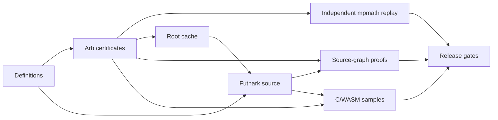

# futhark-bessel

Provenance-clean `J0`, `J1`, and positive `J1` roots for Futhark.

> [!IMPORTANT]
> This package is pre-release: its API is unstable and no release accuracy
> envelopes are declared. [RELEASE.md](RELEASE.md) tracks the open gates.

## Use

Use the official Futhark package path from a checkout:

```futhark
import "lib/github.com/Jesssullivan/futhark-bessel/bessel"

let checked = f32_bessel.j0_checked 12.0f32
let root = f64_bessel.positive_j1_root 1
```

`bessel.fut` exports both `f32_bessel` and `f64_bessel`. Checked evaluation
distinguishes finite results, out-of-domain inputs, and nonfinite inputs on
`|x| <= 1024`; cached and recomputed roots accept indices `1..256`.

## Evidence



Exact-real certificates cover switches and reduction cells/ties; source-graph
proofs cover floating-point operations and adjacent transition-band
composition. Neither certifies backend lowering, contraction, or reassociation.
C/WASM samples are regression tripwires, not whole-domain release envelopes;
WebGPU is compile-checked only.

The root table is a reproducible cache, not numerical authority.
`positive_j1_root_solved` is a separate recomputation path; its source-graph and
mathematical-root bounds are in
[`solver-root-envelopes.json`](evidence/solver-root-envelopes.json), while bracket
containment and reported-residual accuracy remain uncertified.

Machine-readable evidence lives in [`evidence/`](evidence/). Method provenance
is in [`provenance.json`](evidence/provenance.json); focused recipes are listed by
`nix develop --command just --list`.

## Reproduce

Run the pinned repository gate:

```sh
nix develop --command just check
```

`nix develop --command just release-preflight` stays fail-closed until every
release gate has evidence.

Development is tracked under Wavegen TIN-3715. Licensed under the
[ISC License](LICENSE).
